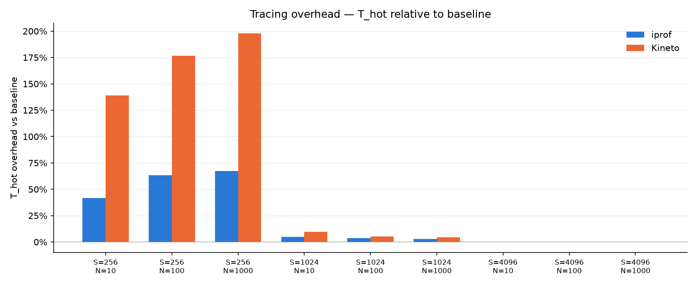
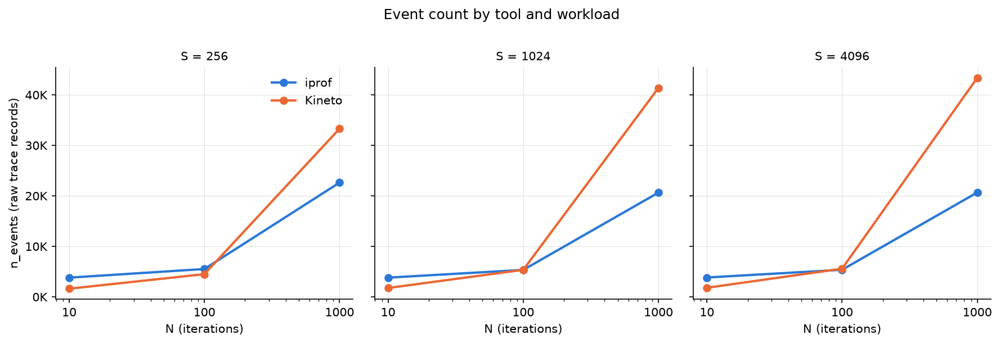
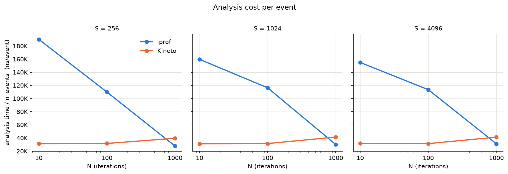

# iprof vs Kineto

**Date**: 2026-10-26  
**Platform**: Aurora (Intel XPU, 1 node)  

### Setup

| Item | Detail |
|---|---|
| Workload (t_hot) | `torch.matmul(x, x)`, XPU tensor, shape (S, S) |
| Warm-up | W = 5 iterations (traced, excluded from T_hot) |
| Repetitions | 15 |
| Parameter grid | S ∈ {256, 1024, 4096} × N ∈ {10, 100, 1000} |
| iprof (t_process, t_hot) | `default`, `--no-analysis --backends pytorch,ze` |
| Kineto (t_process, t_hot) | `ProfilerActivity.CPU + XPU`; analysis via `prof.key_averages()` |
| iprof (t_analysis) | `--replay` |
| Kineto (t_analysis) | `prof.key_averages()` |
| iprof (n_events) | `babeltrace2 raw_trace \| wc -l` |
| Kineto (n_events) | `sum(e.count for e in prof.key_averages())` |
| Summary statistic | Mean across 15 reps; error reported as sample standard deviation (σ) |

---

### T_hot overhead

`T_hot` is the wall time of the hot loop (warmup excluded). Overhead is reported as
`(T_hot_traced − T_hot_BL) / T_hot_BL × 100%`.

| S | N | BL mean ± std (s) | iprof mean ± std (s) | iprof overhead | Kineto mean ± std (s) | Kineto overhead |
|---|---|---|---|---|---|---|
| 256 | 10 | 0.000298 ± 0.000005 | 0.000422 ± 0.000007 | **+41.9%** | 0.000711 ± 0.000012 | **+138.9%** |
| 256 | 100 | 0.002113 ± 0.000027 | 0.003448 ± 0.000027 | **+63.2%** | 0.005843 ± 0.000116 | **+176.5%** |
| 256 | 1000 | 0.019773 ± 0.000169 | 0.033114 ± 0.000187 | **+67.5%** | 0.058890 ± 0.000679 | **+197.8%** |
| 1024 | 10 | 0.001156 ± 0.000002 | 0.001210 ± 0.000007 | +4.7% | 0.001266 ± 0.000008 | +9.5% |
| 1024 | 100 | 0.011094 ± 0.000003 | 0.011511 ± 0.000006 | +3.8% | 0.011672 ± 0.000013 | +5.2% |
| 1024 | 1000 | 0.111501 ± 0.000121 | 0.114718 ± 0.000074 | +2.9% | 0.116336 ± 0.000091 | +4.3% |
| 4096 | 10 | 0.064577 ± 0.000073 | 0.064611 ± 0.000067 | ~0% | 0.064637 ± 0.000057 | ~0% |
| 4096 | 100 | 0.691270 ± 0.000640 | 0.691210 ± 0.000325 | ~0% | 0.690923 ± 0.000596 | ~0% |
| 4096 | 1000 | 7.215276 ± 0.011926 | 7.223067 ± 0.011569 | ~0% | 7.229136 ± 0.007675 | ~0% |

---

### Process time

`T_process` is total wall time including Python startup, tracer initialization, warmup, and the hot loop.

| S | N | BL mean ± std (s) | iprof mean ± std (s) | Kineto mean ± std (s) |
|---|---|---|---|---|
| 256 | 10 | 2.039 ± 0.192 | 11.585 ± 2.022 | 3.059 ± 0.043 |
| 256 | 100 | 1.996 ± 0.049 | 10.669 ± 0.589 | 3.165 ± 0.039 |
| 256 | 1000 | 2.001 ± 0.010 | 10.859 ± 0.417 | 4.597 ± 0.029 |
| 1024 | 10 | 2.065 ± 0.024 | 10.872 ± 0.628 | 3.127 ± 0.033 |
| 1024 | 100 | 2.094 ± 0.030 | 11.377 ± 0.839 | 3.277 ± 0.038 |
| 1024 | 1000 | 2.163 ± 0.028 | 11.211 ± 0.834 | 5.159 ± 0.056 |
| 4096 | 10 | 2.171 ± 0.047 | 10.511 ± 0.284 | 3.222 ± 0.025 |
| 4096 | 100 | 2.787 ± 0.011 | 11.025 ± 0.100 | 3.974 ± 0.027 |
| 4096 | 1000 | 9.408 ± 0.169 | 17.987 ± 0.445 | 12.461 ± 0.061 |

- Initialization has a fixed cost of approximately 2 seconds, as shown by the BL mean across `S=256–4096` and `N=10–100`. Matrix multiplication adds only a few microseconds to the total execution time.
- For `S=4096` and `N=100`, the workload adds approximately 7 seconds to the execution time, exceeding the fixed initialization cost, see Section **_T_hot overhead_**.

---

### Event counts

`n_events` is deterministic across reps (std = 0 for all cells).

| Tool | S | N=10 | N=100 | N=1000 | events/matmul |
|---|---|---|---|---|---|
| iprof | 256 | 3,805 | 5,515 | 22,627 | ~19 |
| iprof | 1024 | 3,808 | 5,338 | 20,644 | ~17 |
| iprof | 4096 | 3,834 | 5,364 | 20,670 | ~17 |
| Kineto | 256 | 1,617 | 4,497 | 33,300 | ~32 |
| Kineto | 1024 | 1,755 | 5,355 | 41,358 | ~40 |
| Kineto | 4096 | 1,799 | 5,579 | 43,382 | ~42 |

---

### Analysis cost

> **Finding**: iprof analysis cost per event decreases with N.

`analysis_s` is the time to post-process the trace (`iprof --replay` for iprof,
`prof.key_averages()` for Kineto).

| Tool | S | N=10 | N=100 | N=1000 | Scaling |
|---|---|---|---|---|---|
| iprof | 256 | 0.723 ± 0.401 s | 0.606 ± 0.010 s | 0.627 ± 0.018 s | flat |
| iprof | 1024 | 0.608 ± 0.049 s | 0.621 ± 0.055 s | 0.620 ± 0.012 s | flat |
| iprof | 4096 | 0.594 ± 0.008 s | 0.609 ± 0.010 s | 0.643 ± 0.055 s | flat |
| Kineto | 256 | 0.051 ± 0.001 s | 0.142 ± 0.001 s | 1.315 ± 0.005 s | O(n) |
| Kineto | 1024 | 0.055 ± 0.001 s | 0.169 ± 0.002 s | 1.711 ± 0.017 s | O(n) |
| Kineto | 4096 | 0.057 ± 0.001 s | 0.175 ± 0.002 s | 1.787 ± 0.023 s | O(n) |
